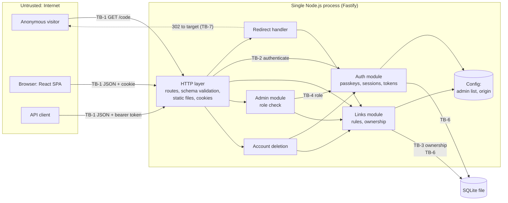
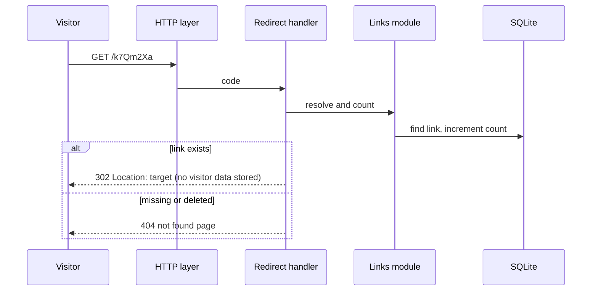
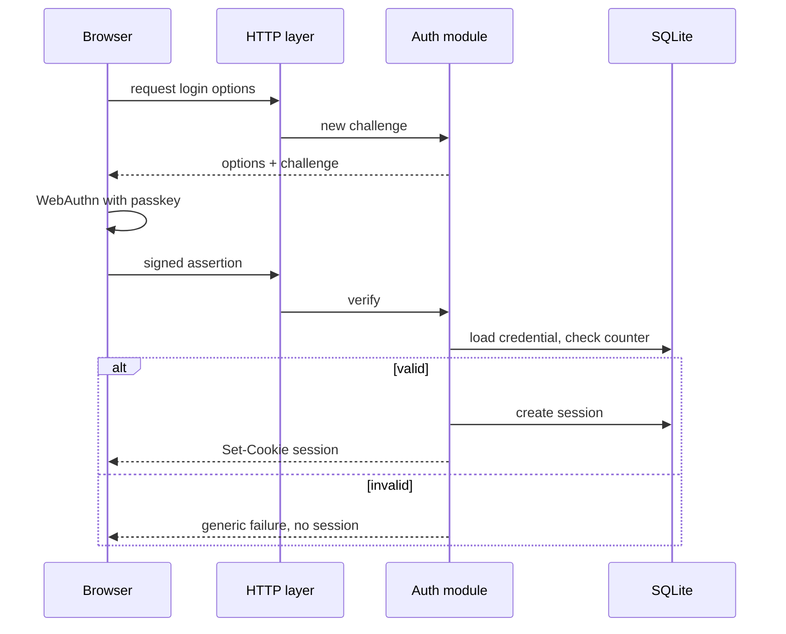

# shrink-182 — Architecture

This file owns HOW the system is built: components, boundaries, technology, and data flow. WHAT the system must do is in `REQUIREMENTS.md`, and how it looks is in `DESIGN.md`. Detailed security controls belong to `SECURITY.md`. IDs (`DR-n`, `AQ-n`) are permanent and are never renumbered or reused.

Versions were checked on 2026-11-11 against the npm registry and the Node.js release schedule (`nodejs/Release` `schedule.json`).

> **Note on answers:** The project owner asked for the open questions to be answered as best as possible. Those answers are marked *(proposed default)* so the owner can review them.

## Required Architecture Inputs

- **Requirements and design sources:** `REQUIREMENTS.md` (FR-1 to FR-7, NFR-1), `DESIGN.md` (DQ-1 deferred).
- **Target surfaces:** Web UI and JSON API. No background jobs.
- **Runtime and deployment environment:** Node.js, run as one process on one host (NFR-1.2). The demo runs on a developer machine at `http://localhost`; a hosted environment is not required. *(proposed default, from AQ-3)*
- **Server framework:** Fastify 5 (explicit choice).
- **Client frameworks:** React 19 (explicit choice), built as a single-page app.
- **API style:** JSON over HTTP. One JSON API serves both the web UI (session cookie) and API clients (bearer API token). Short-link redirects are plain HTTP 302 responses.
- **Authentication and session model:** Passkeys (WebAuthn) for sign-up and login (FR-1.1 to FR-1.7). Server-side sessions keyed by an opaque cookie, with 24-hour idle and 7-day absolute expiry (FR-1.10). Personal API tokens for the JSON API (FR-5.5 to FR-5.7).
- **Authorization model:** Two roles, user and admin (FR-7.1). Admins are listed in deployment configuration (FR-7.2). Link ownership is checked on every link read, edit, and delete (FR-4.6).
- **Data store and expected scale:** One embedded SQLite database file. Up to 100 users (NFR-1.1). Link count and traffic: UNKNOWN.
- **Logging library or platform logger:** Fastify's built-in logger (pino). PROPOSED: it ships with Fastify, so nothing extra is needed.
- **Security expectations:** Owned by `SECURITY.md`. This file only names the enforcement points.

## Stack

| Technology | Version line | Justified by | Status |
|---|---|---|---|
| Node.js | 24.x LTS ("Krypton", maintenance LTS until 2028-04-30) | Explicit choice (Node.js API). 24 is installed locally and supported for longer than the demo needs. *(proposed default, from AQ-1)* | CONFIRMED |
| Fastify | 5.x (5.12.8) | Explicit choice (server framework). Its built-in JSON schema validation and logger cover FR-2.4, FR-2.8 to FR-2.11, and FR-5.4 without extra packages. | CONFIRMED |
| React + react-dom | 19.x (19.3.1) | Explicit choice (client). Serves FR-5.1. | CONFIRMED |
| `node:sqlite` (built into Node) | Ships with Node 24; stability 1.2 "release candidate" | Stores users, passkeys, sessions, tokens, and links. Built in, so no package is needed. The release-candidate status is accepted for a demo. *(proposed default, from AQ-2)* | CONFIRMED |
| `@simplewebauthn/server` | 14.x (14.1.0, needs Node ≥ 22) | FR-1.1 to FR-1.7. Node has no WebAuthn verification (attestation and assertion parsing, COSE keys), and writing it by hand is risky. | PROPOSED: the widely used maintained WebAuthn server library. |
| `@simplewebauthn/browser` | 14.x (14.0.0) | FR-1.1, FR-1.2, FR-1.6. Wraps `navigator.credentials` and the base64url encoding the server library expects. | PROPOSED: matches the server library. |
| `@fastify/cookie` | 11.x (11.1.5) | FR-1.9, FR-1.10 session cookie. Fastify core does not parse or set cookies. | PROPOSED |
| `@fastify/static` | 10.x (10.1.10) | FR-5.1: serves the built React app and self-hosted fonts (DESIGN.md) from the same process. Fastify core does not serve files. | PROPOSED: keeps a single deployment (NFR-1.2). |
| Vite + `@vitejs/plugin-react` | 8.x (8.3.8) / 6.x (6.3.0) | Builds the React app (FR-5.1). Browsers cannot run JSX directly. | PROPOSED: the standard React build tool. |
| TypeScript | 7.x (7.0.2) | Type-checking for the toolchain section. Development only. The server runs `.ts` files directly through Node 24's type stripping, so there is no server build step. *(proposed default, from AQ-4)* | CONFIRMED |
| Vitest | 5.x (5.1.0) | Tests for business rules and API routes. Development only. `node:test` would also work. | PROPOSED: shares Vite's config and supports the React code. |

No router library, state library, ORM, or CSS framework is proposed. The UI has a handful of screens, and the platform plus React cover them.

## Components and Flows

| Component | Responsibility | Business rules enforced | Data owned | Requirement IDs | Status |
|---|---|---|---|---|---|
| Web client (React SPA) | Screens for sign-up, login, links, tokens, account, admin. Calls the JSON API. | None authoritative. It repeats validation only for friendly messages. | None (no browser storage of secrets) | FR-5.1, FR-5.5, DESIGN.md | SUPPORTED (DQ-1 deferred) |
| HTTP layer (Fastify routes) | Routing, request schema validation, JSON error shape, static files, cookie handling | Request shape and size limits; uniform JSON errors | None | FR-5.2 to FR-5.4 | SUPPORTED |
| Auth module | Passkey registration and login, sessions, logout, expiry, API tokens, caller identity | FR-1.3, FR-1.4, FR-1.8 (no recovery path), FR-1.10, FR-5.6, FR-5.7 | Users, passkey credentials, sessions, API tokens | FR-1.1 to FR-1.10, FR-5.5 to FR-5.8 | SUPPORTED |
| Links module | Create, list, edit, delete links; code generation; URL rules; ownership | FR-2.4 to FR-2.11, FR-4.3, FR-4.6, FR-4.9 to FR-4.12 | Short links, retired short codes | FR-2.x, FR-4.x | SUPPORTED |
| Redirect handler | Resolve a short code, count the click, return 302 or not-found | FR-3.3 to FR-3.8; no visitor data stored | None (asks Links module to increment count) | FR-3.1 to FR-3.8 | SUPPORTED |
| Admin module | List all links and users, delete any link, delete other users | FR-7.3 to FR-7.6; admin cannot edit others' links or delete self | None (uses Links and Auth modules) | FR-7.x | SUPPORTED |
| Account deletion | Delete a user with their links and tokens | FR-1.11, FR-5.8, FR-4.12 (codes stay retired) | None (coordinates Auth and Links) | FR-1.11, FR-5.8, FR-7.5 | SUPPORTED |
| Configuration | Admin list (internal user IDs), site origin (also the WebAuthn relying-party ID), database path. Read from environment variables at startup. *(proposed default, from AQ-3 and AQ-5)* | FR-7.2; FR-2.10 needs the site's own domain | Deployment config | FR-7.2, FR-2.10 | SUPPORTED |
| SQLite store | Durable storage | Unique short codes (FR-2.6), never-reused codes (FR-4.12) | All persistent data | NFR-1.1, NFR-1.2 | SUPPORTED |

### Main data flows

1. **Sign up / log in (passkey):** Browser asks API for options → server creates a one-time challenge → browser runs WebAuthn → server verifies the response, then creates a user (sign-up) or finds the user (login) → server creates a session and sets the cookie. A failed check creates no session (FR-1.3).
2. **Create a link:** Web UI (cookie) or API client (token) sends URL and title → HTTP layer validates the shape → Auth module resolves the caller → Links module applies URL rules, generates a 7-character code not already used or retired, and stores it with the owner → short URL returned.
3. **Follow a short link:** Anonymous `GET /<code>` → Redirect handler looks up the code → if found, increments the click count and returns 302 to the target; otherwise returns not-found. Nothing about the visitor is stored (FR-3.5).
4. **Manage own links:** List, edit, delete calls → Auth resolves caller → Links module filters or checks by owner. "Not owned" and "does not exist" give the same not-found result (DESIGN.md).
5. **API tokens:** Created in the web UI (session only), shown once, stored only as a hash. API requests send the token as a bearer header; Auth module looks up the hash and rejects revoked or unknown tokens.
6. **Admin actions:** Session caller → Auth checks whether the caller's internal user ID is in the configured admin list. The ID is shown on the user's own account page so the operator can copy it into config. *(proposed default, from AQ-5)* → Admin module calls Links or Account deletion.

### Trust boundaries and enforcement points

- **TB-1 Internet → server (all requests):** untrusted input. **Validation** is enforced in the HTTP layer (request schemas) and again in the Links module (business rules). Clients are never trusted to validate.
- **TB-2 Anonymous → authenticated:** **Authentication** is enforced once, in the Auth module, before any route except sign-up, login, the redirect handler, the signed-out page, and static files. Session cookies are accepted for the web UI; bearer tokens are accepted for the JSON API.
- **TB-3 User → another user's data:** **Authorization** (ownership) is enforced in the Links module on every read, edit, and delete, not in the routes or the UI.
- **TB-4 User → admin:** **Authorization** (role) is enforced in the Admin module entry point using the configured admin list.
- **TB-5 Server → browser (rendering):** user titles and URLs are output as plain text by React. Detailed output rules are owned by `SECURITY.md`.
- **TB-6 Server → SQLite file:** trusted local store. Queries use bound parameters only. File protection is owned by `SECURITY.md`.
- **TB-7 Redirect → external target:** the system sends visitors to user-supplied URLs. Only `http`/`https` targets that are not shrink-182's own domain are allowed (FR-2.8, FR-2.10).

## Dependency Rules

- **DR-1** Dependencies point one way: HTTP layer → domain modules (Auth, Links, Admin, Account deletion) → store. Nothing points back up. There are no cycles.
- **DR-2** Business rules (URL rules, code generation, ownership, roles, session expiry) live only in the domain modules. Routes, React components, and the database layer contain no business rules.
- **DR-3** The Auth module alone owns users, passkey credentials, sessions, and API tokens. Other modules ask it for the caller's identity and role and never read those tables.
- **DR-4** The Links module alone owns short links and retired codes. Other modules change links only through it.
- **DR-5** Admin and Account deletion own no data. They coordinate Auth and Links through those modules' functions.
- **DR-6** Vendor code (`@simplewebauthn/*`, `node:sqlite`, Fastify plugins) is used only behind the module that needs it: WebAuthn inside Auth, SQLite inside the store, Fastify inside the HTTP layer.
- **DR-7** The web client depends on the JSON API only. It shares no code with the server except, optionally, request and response type definitions.
- **DR-8** The Redirect handler depends on the Links module only and must not depend on Auth.

## Diagrams

### Components and trust boundaries

### Following a short link

### Passkey login

## Toolchain

Commands assume npm, which ships with Node. Script names are PROPOSED and become real when `package.json` exists.

| Check | Command | Notes |
|---|---|---|
| Install | `npm ci` | Uses the lockfile. `npm install` for the first install. |
| Build | `npm run build` → `vite build` | Builds the React app into static files for `@fastify/static`. The server runs from TypeScript source with Node's type stripping. |
| Type-check | `npm run typecheck` → `tsc --noEmit` | |
| Test | `npm test` → `vitest run` | |
| Dependency audit | `npm audit --audit-level=high` | Built into npm. |
| Lint | N/A | Not required for a demo. Can be added later. |
| Run | `npm start` → `node` on the server entry | |

Note for local use: on this machine, `npm` failed with `EPERM` because `~/.npm` contains root-owned files. Fix with `sudo chown -R 503:20 ~/.npm` before installing.

## Open Questions

Resolved and removed: AQ-1 (Node 24), AQ-2 (`node:sqlite`), AQ-3 (localhost demo, origin from config), AQ-4 (TypeScript), AQ-5 (admins listed by internal user ID). Their answers are recorded above as proposed defaults.

- **AQ-6** *(deferred — revisit in steps 07 and 09; from OQ-15)* Rate limits and caps on open sign-up. If needed, `@fastify/rate-limit` would be the candidate package.
